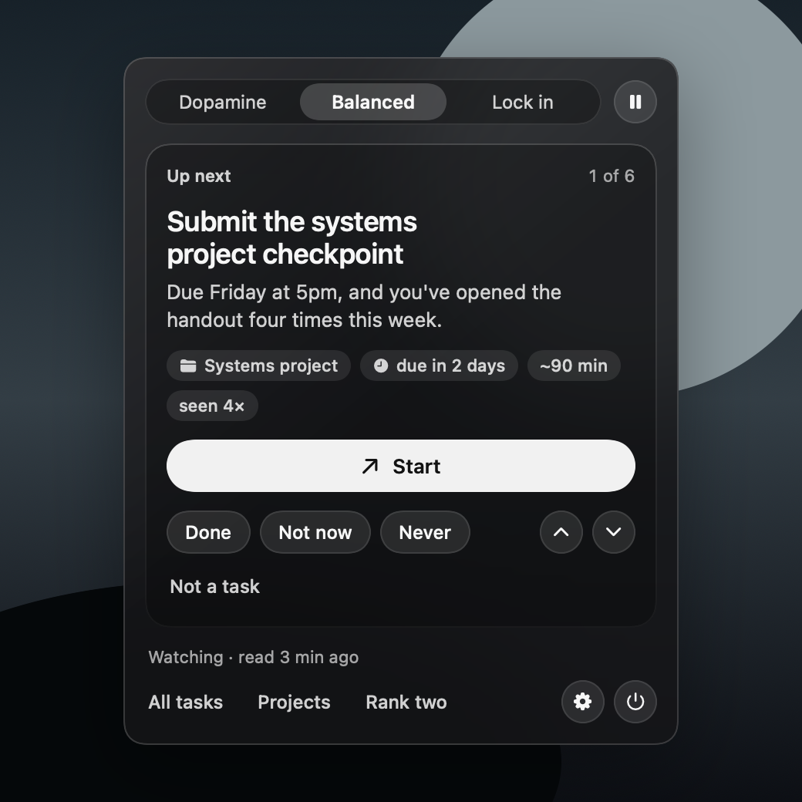
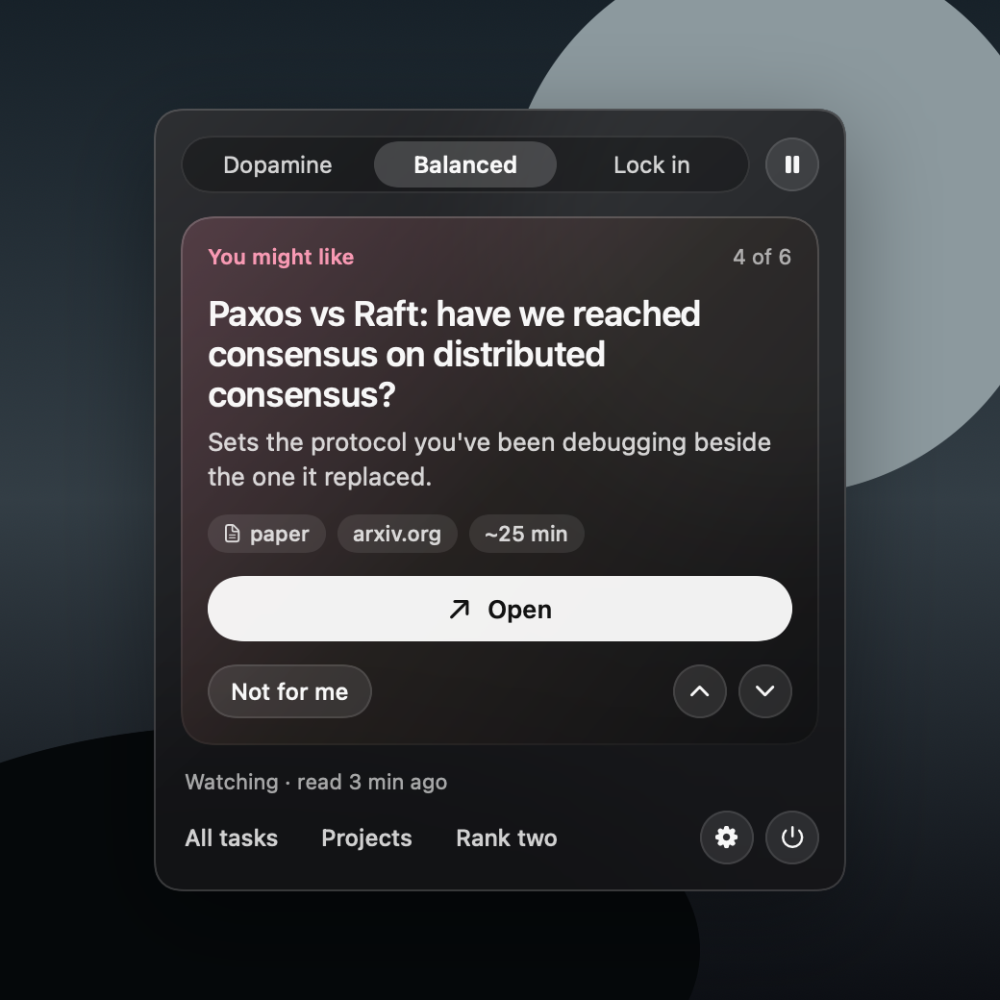
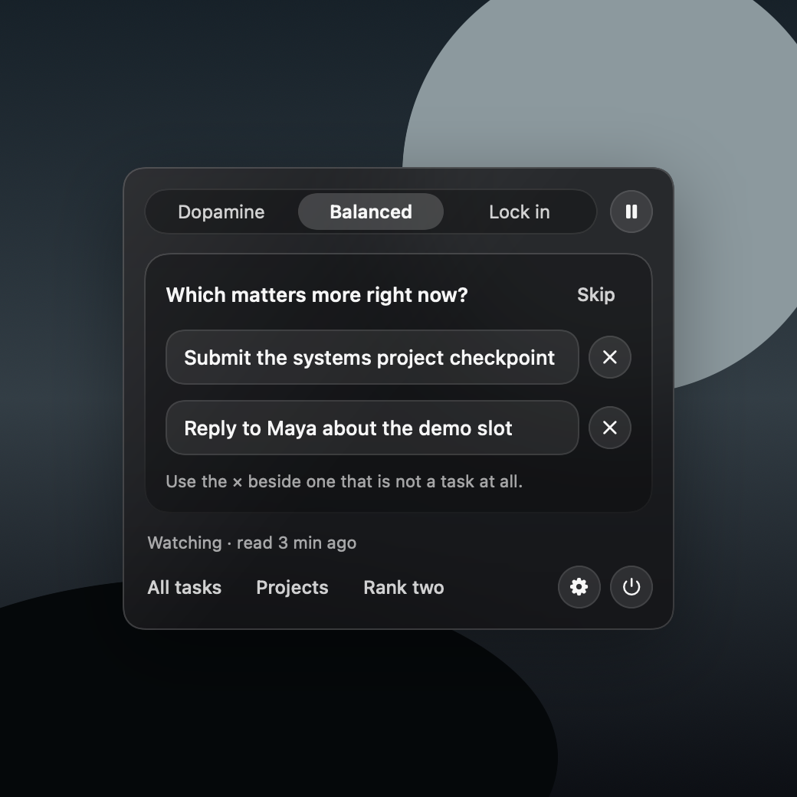
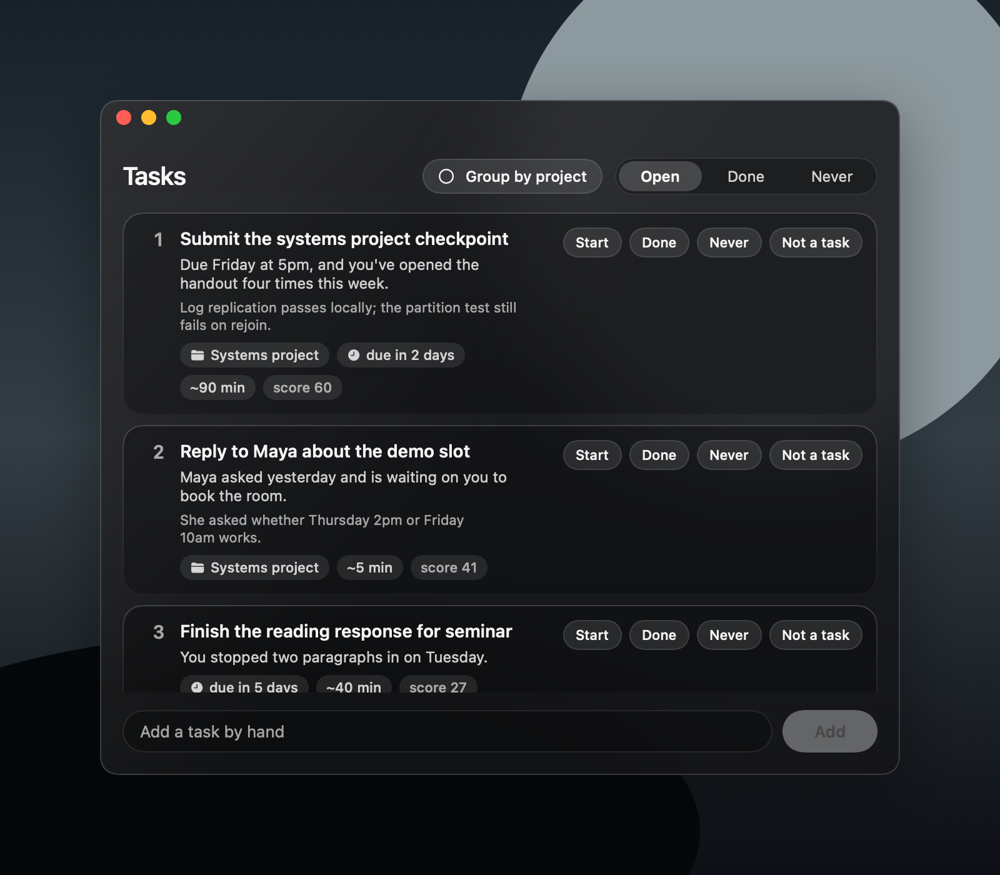
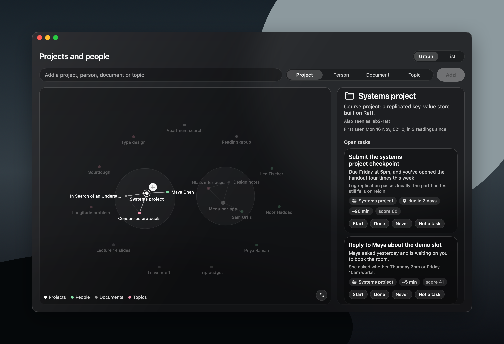
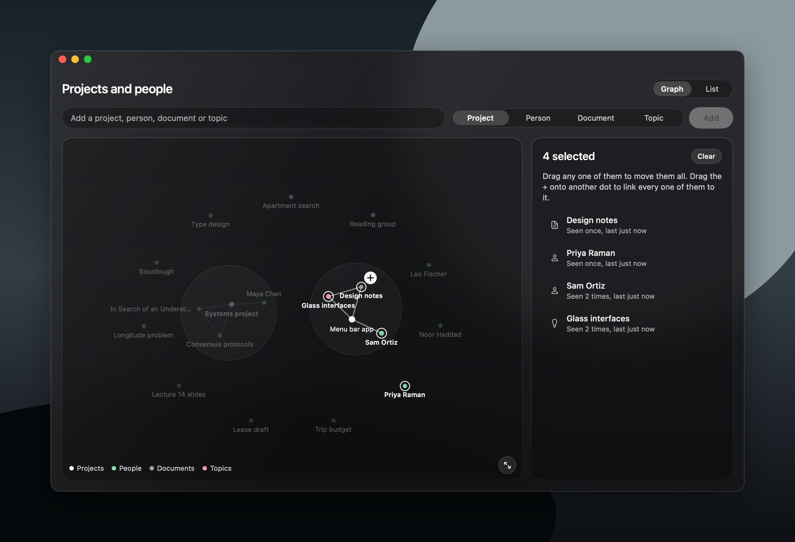
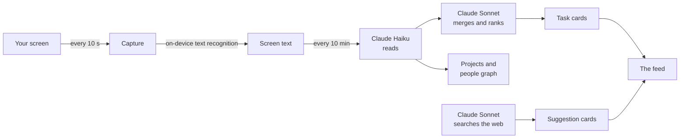

<div align="center">

# Lifescroll

**A to-do list you never have to write.**

Lifescroll sits in your Mac's menu bar, reads what is on your screen, works out what you left
unfinished, and shows you one card at a time saying what to do next.


[Features](#features) ·
[Quick start](#quick-start) ·
[Using it](#using-it) ·
[How it works](#how-it-works) ·
[Privacy](#privacy) ·
[Development](#development)

<br>





</div>

<br>

> [!NOTE]
> Every screenshot on this page is drawn from invented sample data. None of it is anyone's real
> screen, tasks or contacts.

## Why

Most task apps fail at the same step: you have to remember to write the task down. Lifescroll skips
that step. It notices the email you opened and did not answer, the assignment page you keep going
back to, the pull request you left half-reviewed, and puts each on a card.

It is also honest about how people actually work. You will scroll. So the feed mixes things worth
doing with things worth enjoying, and when you have been scrolling too long it nudges you with the
one card that matters most.

## Features

- **Tasks appear by themselves.** Lifescroll reads your screen every ten minutes and adds what you
  left unfinished. You can still add one by hand.
- **One card at a time.** Each card says what to do and why now, with a deadline, a time estimate
  and one main button: **Start**.
- **Ranked for you, corrected by you.** Importance, deadlines and who is waiting set the order.
  Now and then it asks "which matters more?", and your answer outweighs its guess.
- **A feed for life, not just work.** Suggestions (a paper, an essay, a talk) are found by Claude
  searching the web for things like what you already read and watch.
- **Nudges when you drift.** Scroll too long and the top card arrives as a notification.
- **Three modes.** Pure dopamine, Balanced, or Lock in, depending on the day you are having.
- **It learns what is not a task.** Mark a card **Not a task** and things like it stop appearing.
- **A map of your work.** Projects, people, documents and topics become a live graph you can
  explore, rearrange and link by hand.
- **Local by default.** Everything is stored on your Mac. Only screen text goes to Claude to be read.

## Quick start

**You need:** macOS 14 or later, Apple's Command Line Tools (`xcode-select --install`; full Xcode is
not needed), and a [Claude API key](https://console.anthropic.com/).

```bash
git clone https://github.com/artalogica/lifescroll.git
```

```bash
cd lifescroll && ./scripts/build-app.sh
```

```bash
open build/Lifescroll.app
```

Then, the first time it runs:

1. Allow **Screen Recording** when macOS asks, quit Lifescroll (the power icon in its popover) and
   open it again.
2. Allow notifications.
3. Click the menu bar icon, open **Settings** (the gear) and paste your Claude API key. It is saved
   in your Keychain.
4. Optional: allow **Accessibility** in Settings for more reliable window titles.

Your first cards appear after the first reading, about ten minutes in.

<details>
<summary><b>Rebuilding often? Keep your permissions between builds</b></summary>

<br>

macOS grants Screen Recording, Accessibility and Keychain access to one signed copy of an app.
Without a signing certificate each rebuild counts as a new app, and System Settings goes on showing
the old copy as allowed while the new one has nothing.

Create a certificate once and the build script signs with it from then on:

1. Open **Keychain Access**.
2. Choose **Keychain Access › Certificate Assistant › Create a Certificate…**
3. Name it `Lifescroll Dev`, set Identity Type to **Self-Signed Root** and Certificate Type to
   **Code Signing**, then create it.

Rebuild, clear the grants left by earlier builds, and allow the permissions one last time:

```bash
./scripts/build-app.sh
```

```bash
tccutil reset ScreenCapture local.lifescroll.Lifescroll
```

```bash
tccutil reset Accessibility local.lifescroll.Lifescroll
```

```bash
open build/Lifescroll.app
```

The first signed build asks whether `codesign` may use the new key; choose **Always Allow**. The
script prints which way it signed. To sign with a different identity, set `LIFESCROLL_SIGN_IDENTITY`.

</details>

## Using it

### The feed

Click the menu bar icon to see the top card. Scroll with the trackpad, mouse wheel or arrow keys to
see the next; after the last card the first comes back.

| Button | What it does |
|---|---|
| **Start** | Marks the task in progress and opens its link or app. It moves to the front of the feed and shows how long it has been going. |
| **Done** | Finished. Takes it off the list. |
| **Pause** | Stops a task in progress and puts it back among the others. |
| **Not now** | Hides it for three hours. |
| **Never** | A real task, but you will not do it. Gone for good. |
| **Not a task** | It never was one. Gone for good, and things like it stop being suggested. |

### Modes

| Mode | Nudge | Feed |
|---|---|---|
| **Pure dopamine** | never | three suggestions, then a task |
| **Balanced** | after 20 minutes of scrolling | one suggestion after every three tasks |
| **Lock in** | after 5 minutes of scrolling | tasks only, and no suggestions are fetched |

### All tasks

Every task, ranked, with its reason, deadline, estimate and score. Finished and dismissed tasks can
be reopened from here.



### Projects and people

The **Projects** button opens everything Lifescroll has noticed you working with as a graph.
Entries joined by links gather into clusters, each on its own faint backdrop with its
best-connected entry in bold. Entries with no links yet sit around the outside.



| To | Do this |
|---|---|
| See an entry's tasks, links and history | Click its dot |
| Link two entries | Drag the **+** beside a selected dot onto another, or click the **+** and then the other dot |
| Remove a link | Use the × beside it in the side panel |
| Move a dot, or the whole picture | Drag the dot, or drag empty space |
| Zoom | Pinch, or hold Command and scroll |
| Bring everything back into view | Double-click empty space, or use the corner button |
| Select several | Shift-click dots, or hold Shift and drag a box around them (Command-A selects all) |
| Move or link a group | Drag any one of them, or drag the group's **+** onto another dot |
| Add an entry by hand | Type a name in the field above the graph |



Two entries are linked automatically only when a screen actually showed them to be related: a
person posting in a project's channel, a paper about a topic. Being on screen at the same time
links nothing.

## How it works



| Step | How often | What happens |
|---|---|---|
| **Watch** | every 5 s | Logs the front app and window title, counts time on "scrolling" apps and fires the nudge. No model is involved. Stops while the screen is locked or the display is off. |
| **Capture** | every 10 s | Captures the display under the pointer, skipping unchanged frames and excluded apps. About every 30 s, and whenever a new window comes forward, the text is read off the capture on your Mac. |
| **Read** | every 10 min | Claude Haiku 5.5 is sent the text of up to 12 key screens, cut down to lines not already sent, and reports commitments, completions and what you were looking at. |
| **Index** | after each read | The projects, people, documents and topics Haiku named are matched against the graph by name. Claude Sonnet 5.5 is called only for names not seen before. |
| **Merge** | after each read | Claude Sonnet 5.5 merges commitments into the task list, sets importance, links each task to its project and writes each card's "why now" line. |
| **Suggest** | when fewer than 4 are on hand, at most every 2 h | Claude Sonnet 5.5 searches the web (up to 5 searches) for things like what you have been reading, and chooses up to 8 worth a card. If the search finds nothing, it falls back to arXiv and Hacker News. |

**Text first.** Text recognition runs on-device with Apple's Vision framework, so Claude is sent
words, not pictures, for most screens. Only the screens with almost no text also send their
screenshot. On 12 real screenshots this came to about half the tokens of sending every image.

**Ranking** is a hand-written score (`Ranker.score` in `Logic.swift`): importance, deadline
urgency, how often and how recently you saw it, whether someone is waiting, and your "which matters
more?" answers.

## Privacy

Lifescroll watches your screen, so this section matters more than any other.

- **Stored on your Mac.** The database and screenshots live in
  `~/Library/Application Support/Lifescroll/`. There is no account and no server of ours.
- **What leaves your Mac.** Screen text, and a screenshot for the few screens with almost no text,
  go to the Claude API to be read. Suggestion searches send topics, never your name or your private
  project names.
- **Never-capture list.** Windows matching a word you choose, and Lifescroll's own windows, are
  removed from the picture by the system before it is taken. If such a window is in front, the
  capture is skipped altogether.
- **Secrets are masked.** Things shaped like API keys, tokens and card numbers are masked before
  text is stored or sent. This is a safety net for obvious shapes, not a guarantee.
- **Short memory.** Screen text is erased as soon as it has been read, and erased rows are
  overwritten in the database file. Screenshots are deleted after three days.
- **Screen text is treated as content.** It is sent to the model marked as material to report on,
  never as instructions to follow.
- **Your key, your bill.** Requests go out under your own Claude API key, kept in your Keychain.
  Anthropic charges for tokens and, separately, for each web search; Settings shows what has been
  used.

## Development

Lifescroll is a Swift Package with no dependencies beyond the system. It builds with the Command
Line Tools alone. Those ship without XCTest, so the checks are built into the app:

```bash
swift build && .build/debug/Lifescroll --self-test
```

<details>
<summary><b>More commands</b></summary>

<br>

Confirm a new build can open your existing data. Point it at a copy, because opening a file brings
it up to the current schema:

```bash
.build/debug/Lifescroll --check-db /path/to/copy.sqlite
```

Draw the interface to images over a light and a dark backdrop, using invented sample data. This is
how the screenshots on this page were made:

```bash
.build/debug/Lifescroll --render-ui build/ui-preview
```

Draw the Projects window from a database file, to see how a real graph lays out. Use a copy:

```bash
.build/debug/Lifescroll --render-graph /path/to/copy.sqlite build/graph.png
```

Run one real search against arXiv and Hacker News, with no Claude calls. arXiv answers 429 when
requests come too close together, so leave a while between runs:

```bash
.build/debug/Lifescroll --fetch-test "distributed consensus"
```

Time text recognition on your newest stored screenshots. It prints counts, never the text:

```bash
.build/debug/Lifescroll --ocr-test 12
```

</details>

<details>
<summary><b>Where things are</b></summary>

<br>

| File | Contents |
|---|---|
| `Sources/Lifescroll/Capture.swift` | Front-window sampling and screenshots |
| `Sources/Lifescroll/ScreenText.swift` | On-device text recognition, masking of secrets, trimming repeated lines |
| `Sources/Lifescroll/Analyzer.swift` | Prompts, JSON schemas, the read and merge steps |
| `Sources/Lifescroll/Recommendations.swift` | Web search, arXiv and Hacker News, and choosing suggestions |
| `Sources/Lifescroll/ClaudeClient.swift` | Raw HTTP to the Claude Messages API, Keychain storage |
| `Sources/Lifescroll/Logic.swift` | Ranking, nudge timing, key-frame choice, applying merge decisions |
| `Sources/Lifescroll/Store.swift` | The SQLite schema and every query |
| `Sources/Lifescroll/AppModel.swift` | Timers, card actions, notifications |
| `Sources/Lifescroll/Views.swift` | Popover, task list, projects and settings |
| `Sources/Lifescroll/Graph.swift` | The graph: layout, physics, pointer handling and drawing |
| `Sources/Lifescroll/Theme.swift` | The smoked-glass look: panels, cards, buttons, switches, chips |
| `Sources/Lifescroll/Preview.swift` | Draws the interface to images with sample data |
| `Sources/Lifescroll/SelfTest.swift` | The checks run by `--self-test` |

Data lives in `~/Library/Application Support/Lifescroll/`: `lifescroll.sqlite` and a `frames/`
folder. The `events` table records every card shown and every response to it.

</details>

## Troubleshooting

<details>
<summary><b>Settings says Screen Recording or Accessibility is off, but System Settings shows it allowed</b></summary>

<br>

The grant belongs to an earlier build. Follow
[Keep your permissions between builds](#quick-start) once, and it will not happen again.

</details>

<details>
<summary><b>The build stops with <code>errSecInternalComponent</code></b></summary>

<br>

The keychain refused the signing key for a moment. Run the build again. If macOS asks whether
`codesign` may use the key, choose **Always Allow**.

</details>

<details>
<summary><b>No cards are appearing</b></summary>

<br>

Check that a Claude API key is saved in Settings and that Screen Recording is allowed, then give it
ten minutes: tasks arrive after each reading. The popover's status line says when it last read.

</details>
